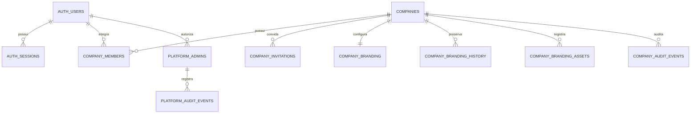
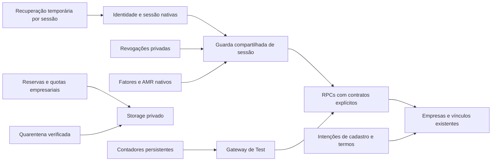

# Segurança e modelagem — publicação em Test

## Atualização de 26/10/2026

- Continuação no PR #114, sem nova migration e sem alteração de Live.
- Backup atual confirmado pelo próprio Agendador: `test-20261026T173417Z`, com restauração, cifra/decifragem conferidas e recibo externo. A tarefa retornou 0 e `last-run.json` registrou `succeeded` com o novo arquivo.
- Acrescentado wrapper que exige comprovante novo e arquivo cifrado existente antes de retornar sucesso. Casos sintéticos de comprovante recente, antigo, ausente e falha do coletor passaram no Windows. Um problema de conversão de datas JSON foi detectado por esses testes e corrigido.
- Validação autenticada no navegador identificou resposta JSON comprimida com zstd sem cabeçalho compatível no proxy. O gateway passou a negociar `identity` a montante; PNG já é comprimido. Regressão com os encodings de um navegador moderno incluída na integração nativa. A correção não relaxa permissões ou lê credenciais.
- Melhoradas as mensagens de MFA/limites e a atualização da tela de Segurança, preservando os campos. Confirmação administrativa pode abrir em outra aba.
- Login administrativo confirmado pelo usuário; cadastro/ativação do fator ainda precisam de confirmação real. Não equiparar login à exigência de MFA concluída.

## Situação da entrega

Implementação publicada pelo [PR #112](https://github.com/MLT-Mateus/JobForged/pull/112), após a compatibilidade do [PR #113](https://github.com/MLT-Mateus/JobForged/pull/113).

- Release funcional validado em Test: `6113d6b0ff5ab2f3808a24b7163c2552d4438a8e`, `/api/health` → `ok`. A revisão operacional de backup/documentação pode produzir SHA posterior, que deve ser conferido no healthcheck e na entrega.
- Aplicação e gateway foram conferidos com o mesmo SHA publicado. Auth, REST, Storage, Envoy e Studio saudáveis.
- Migrations 0001–0030 aplicadas e checksums conferidos pelo runner oficial.
- Live: `4c6cd15cc844a8994d83398ff83150e8becb9c40`, saudável, sem promoção. As duas migrations existentes de Live mantêm os checksums do inventário inicial.
- **MFA obrigatório ainda não ativado:** o responsável precisa cadastrar e confirmar seu autenticador na interface. `admin_mfa_enforced=false` foi conferido no banco, preservando o acesso do único responsável.
- Backup pelo Agendador verificado: tarefa `JobForged-Test-Encrypted-Backup` retornou `0` e produziu `test-20261024T025130Z`, com restauração e cópia cifrada confirmadas. O caminho anterior não era acessível à tarefa; foi substituído por um diretório normal do perfil e SSH sem entrada padrão interativa. Instalador versionado executado e nova execução da tarefa também confirmada.

Não considerar as dez medidas integralmente encerradas nem promover Live enquanto o cadastro/ativação humano de MFA permanecer pendente.

## Modelo preservado e evolução

O modelo aprovado não exige reconstruir as entidades empresariais nem introduzir recrutamento fictício. Foram preservados UUIDs, contas, vínculos, arquivos, histórico e tabelas existentes. A implementação concentra contratos e segurança; não cria entidades de vagas/candidaturas da Frente 4.

O modelo anterior permanece, com os seguintes complementos privados:

| Área | Alteração e compatibilidade |
|---|---|
| Identidade | Auth continua responsável por senhas, refresh tokens, sessões e fatores. Nenhum espelhamento dessas credenciais foi criado. |
| Empresa/vínculo | UUID canônico, papéis/status validados e negação sem vínculo; preservadas regras existentes de responsáveis. |
| Cadastro | Intenção validada de uso único, plano gratuito fixo no servidor, CNPJ/telefone/nome conferidos e versão SHA-256 dos termos efetivamente apresentados. |
| Termos históricos | `companies.terms_revision` é nullable. Nenhum aceite ou versão retroativa foi inventado. |
| Leitura | Contratos `session_context_v1`, `company_read_v1` e projeções explícitas nos retornos restantes. Revogado SELECT direto das tabelas empresariais pelo papel autenticado. |
| Personalização | Rascunho, publicação e histórico mantidos; Storage usa a própria sessão empresarial e reservas. URLs do aplicativo preservadas. |
| Comunicação/administração | Fluxos existentes preservados; operações administrativas sensíveis usam a guarda de MFA quando ativada. |
| Segurança privada | Revogações, recuperação temporária, intenções de cadastro, contadores, reservas, quarentena e autorização auditada de recuperação de fator. |

Não houve remoção de estruturas empresariais nem backfill destrutivo. Migrations já aplicadas não foram editadas. A migration 0017 de compatibilidade permanece imutável; as novas são 0018–0030.

## Matriz de permissões

A coluna administrativa abaixo descreve o estado **após ativar MFA**. Enquanto o cadastro humano está pendente, as permissões administrativas anteriores permanecem disponíveis ao responsável legítimo.

| Perfil | Dados empresariais | Identidade visual/arquivos | Administração |
|---|---|---|---|
| Visitante | Sem leitura empresarial; apenas contratos públicos necessários | Sem arquivos privados | Negada |
| Identidade sem vínculo | Sem dados de empresa; pode concluir convite válido | Negada | Negada, salvo administrador já cadastrado pelas regras existentes |
| Membro ativo | Projeção mínima da própria empresa e colegas ativos | Versão publicada autorizada; sem rascunho/edição | Negada |
| Owner/admin empresarial | Gestão da própria empresa conforme regras existentes | Rascunho, publicação, histórico e uploads com quota | Sem privilégios de plataforma |
| Vínculo inativo/empresa suspensa | Dados e operações empresariais negados | Negados | Sem ampliação de privilégios |
| Admin de plataforma, apenas senha | Próprio estado de segurança | Sem edição da marca empresarial | Operações sensíveis negadas após ativar MFA |
| Admin com fator recente | Backoffice autorizado | Banners de plataforma; sem nova permissão de editar marca empresarial | Operações previstas, com fator validado no servidor/banco há até 5 min |
| Capacidade técnica de quarentena | Nenhuma identidade empresarial | Somente um órfão enfileirado e sua cópia; fora da API pública | Sem acesso administrativo |

Suspensão, inativação, banimento e exclusão são reavaliados no acesso aos dados; um JWT ainda assinado não substitui essas verificações. Operações de identidade do próprio usuário no Auth não equivalem a autorização empresarial.

## Dez medidas: execução e evidências

### 1. Autorização e migrations

- **Estado encontrado:** havia correção anterior de NULL; preservada e revalidada. Sem vínculo não pode resultar em autorização implícita.
- **Executado:** helper retorna negação explícita, guarda de identidade/sessão e wrappers para RPCs; defaults futuros não concedem tabelas/funções indiscriminadamente.
- **Afetados:** 0018, runner `scripts/supabase-migrate.sh`, contratos de sessão do aplicativo.
- **Aceite/resultado:** SQL real e integração nativa passaram para usuário sem vínculo, vínculo inativo, empresa suspensa e separação de empresas. Em Test ativo, 30 checksums conferidos.
- **Residual/dependência:** novas funções devem manter grants explícitos e cobertura do pipeline. Sem pendência externa nesta medida.

### 2. Proteção contra API direta

- **Estado encontrado:** validação de cadastro não podia depender somente do BFF; metadados do cliente não são prova de papel/empresa/plano.
- **Executado:** intenção validada de cadastro e trigger autorizado, recibo consumido e código bruto removido inclusive em updates posteriores do GoTrue; política compartilhada de senha na UI/gateway e requisitos nativos no Auth.
- **Afetados:** 0022/0026, `app/api/auth/sign-up`, `shared/password-policy.*`, gateway e configuração Auth.
- **Aceite/resultado:** cadastro sem intenção e campos indevidos negados; tentativa de obter papel/plano pelos metadados não funcionou. Todos os símbolos aprovados passaram no Auth real. Contrato público de cadastro respondeu 200 em Test.
- **Residual:** o mínimo nativo é medido em bytes pelo GoTrue; entrada pública também exige oito caracteres Unicode e máximo de 72 bytes UTF-8. Fontes privadas de administração não são entradas públicas do aplicativo.

### 3. Restrição de leitura

- **Estado encontrado:** grants/retornos amplos poderiam expor novas colunas e dados desnecessários de colegas.
- **Executado:** projeções explícitas, e-mail/status restritos conforme papel, revisão de branding/comunicação/configurações e revogação do SELECT direto empresarial.
- **Afetados:** 0017–0019/0024, `_server.ts`, APIs empresariais e backoffice.
- **Aceite/resultado:** colunas sentinela futuras não apareceram nos contratos; testes existentes de backoffice/personalização passaram. No banco ativo, SELECT direto de `companies` e `company_members` por authenticated está negado; requisição anônima pública ao roster foi negada.
- **Residual:** novas colunas precisam de decisão explícita para entrar em um DTO. Não publicar `app_private` no PostgREST.

### 4. MFA e autenticação recente

- **Estado encontrado:** único administrador legítimo sem fator; ativar uma exigência imediatamente bloquearia o responsável.
- **Executado:** tela Segurança com componentes compartilhados, TOTP, sessão AAL2 e AMR recentes conferidos também no banco. Exigência gradual, sem criar administrador. Recuperação autoriza um único cadastro de fator, por até 15 min, vinculado à sessão aprovada pelo operador root e auditado.
- **Afetados:** 0018/0025/0030, `backoffice/seguranca`, API de segurança e gateway.
- **Aceite/resultado:** Auth real negou fator ausente/antigo e substituição apenas com senha; recuperação por sessão autorizada e consumo único passaram, sem desligar a exigência nos testes.
- **Pendente:** cadastro e confirmação do fator pessoal pelo responsável em Test, seguido de ativação e conferência do estado real. QR/seed/código não devem ser enviados ao agente.

### 5. Sessões e revogação

- **Executado:** JWT 900 s, rotação habilitada com tolerância de 10 s, sessão de 30 dias e inatividade de 24 h. Guarda de dados verifica sessão, banimento/exclusão e ledger de revogação em cada requisição.
- **Afetados:** 0018/0025/0028, logout/BFF, gateway e Auth Test.
- **Aceite/resultado:** expiração, inatividade, logout, refresh após revogação e troca de senha passaram. A alteração de senha invalidou outras duas sessões da fixture. Configuração do Auth ativo conferida.
- **Prazo real:** ledger/bloqueios empresariais valem na próxima consulta protegida; não se afirma cancelar uma resposta já em andamento. JWTs antigos sem revogação explícita mantêm sua expiração original durante a transição.
- **Residual observado:** replay de refresh antigo foi rejeitado, mas o GoTrue desta versão manteve o token corrente da família. Não afirmar revogação automática da família por esse evento. Sessões concorrentes legítimas continuam permitidas.

### 6. Recuperação de senha

- **Executado:** cookie opaco substitui marcador genérico; autorização hash, temporária, por identidade/sessão, com prova AMR do Auth e consumo atômico. Login/troca de identidade limpam o contexto local.
- **Afetados:** 0019, rotas recovery e `_server.ts`.
- **Aceite/resultado:** link nativo de uso único, sessão diferente, reutilização de nonce e alteração real da senha passaram. Senha antiga deixou de funcionar.
- **Residual:** falha após consumo exige novo link; não se reabre uma autorização consumida. Nenhum link/token completo é registrado.

### 7. Limites, quotas e processamento

- **Executado:** gateway cobre BFF e endpoints públicos dos provedores; IP confiável e escopos HMAC; contadores no PostgreSQL. Quota por empresa de 1.000.000.000 bytes/200 imagens, reserva conservadora de 5 MiB, duas reservas simultâneas e cinco inícios por minuto. Convites: dez por hora/empresa. Processamento administrativo limitado antes de ler/normalizar imagem.
- **Afetados:** 0020/0023/0027/0029, gateway, APIs de upload e worker de quarentena.
- **Aceite/resultado:** limites sobreviveram a reinício e foram compartilhados por duas instâncias; quota/concorrência e RPC direto de convites passaram. Worker real passou isoladamente; em Test executou com sucesso e coletou zero arquivos.
- **Órfãos:** somente uploads não registrados e sem referências após 24 h. Cópia privada com hash/readback antes de remover origem. Histórico e assets registrados nunca entram na coleta. Purge exige sete dias e recibo recente de backup externo contendo a cópia.
- **Residual:** parâmetros de taxa são limites técnicos iniciais; monitorar capacidade antes de ampliar a operação. Retenção deliberadamente mantém arquivos se o computador não produzir recibo externo recente.

### 8. Storage e credenciais

- **Executado:** removido o token técnico global do ambiente da aplicação; RLS exige a sessão e empresa correta. Objetos empresariais imutáveis. Entradas públicas de signing/S3/render/administração bloqueadas. Manutenção usa capacidade curta e exata, emitida pelo operador de infraestrutura, sem papel service_role no app.
- **Afetados:** 0020/0021/0029, `_storage.ts`, APIs de assets, gateway e ambiente Test.
- **Aceite/resultado:** token anterior negado, isolamento, reserva obrigatória, MIME/tamanho indevidos e acesso privado à quarentena passaram com Storage real. Ausência do token no ambiente ativo confirmada.
- **Preservação:** referências e arquivos existentes mantidos. Rascunho/histórico permanecem privados; publicação só permite leitura aos consumidores existentes autorizados. Não foi inventado um bucket público nem infraestrutura de documentos de candidatos inexistente no MVP.
- **Residual:** o segredo de assinatura nativo permanece na infraestrutura protegida; não foi distribuído à aplicação. Troca completa desse segredo é operação distinta com impacto em todas as sessões de Test.

### 9. Studio e infraestrutura

- **Executado:** pooler Test em loopback; Studio atrás de allowlist/túnel e BasicAuth/HTTPS preservados. Ingresso Test dedicado; app, gateway, Studio e Envoy Test fora da rede compartilhada com Live. Traefik recebeu conexão à rede Test sem reinício.
- **Afetados:** scripts `harden-test-*`, `isolate-test-ingress.py`, Compose Test e ambiente da aplicação.
- **Aceite/resultado:** portas externas 5432/6543 negadas, Studio externo 403/local 401; serviços saudáveis e redes conferidas. Comparação de containers/redes/portas de Live e identidade do Traefik passou no deploy.
- **Recuperação:** SSH com hostkey verificada; configurações anteriores guardadas em diretórios root privados. Túnel descrito no relatório de execução, sem desativar TLS.
- **Residual:** SSH da VPS compartilhada ainda permite senha/root. Nenhuma regra global de SSH/UFW ou configuração de Live foi alterada; endurecimento global exige escopo próprio. O host/root continua uma fronteira comum aos ambientes.

### 10. Recuperação e pipeline

- **Executado:** backup consistente de banco/arquivos, escritores Test suspensos brevemente, restauração sem rede/portas/cron, comparação de contagens, metadados e arquivos. AES-256-GCM autenticado com chave DPAPI CurrentUser no computador autorizado, fora de Git/OneDrive; recibo emitido após conferir a decifragem.
- **Afetados:** `scripts/security/*backup*`, restore, recibo externo, gate de migrations e workflow de qualidade.
- **Aceite/resultado:** restauração prévia, upgrade sobre estrutura restaurada e cópia cifrada pós-publicação passaram. Cinco checks obrigatórios bloquearam integração/publicação até aprovação. Testes do gate recusaram backup ausente/antigo/corrompido e divergência de checksum.
- **Backups confirmados:** pré-publicação `test-20261024T010838Z`; pós-publicação manual `test-20261024T023217Z`; execução pelo Agendador `test-20261024T025130Z`, resultado `0` (e teste anterior `test-20261024T024802Z`). Arquivos cifrados em `C:\Users\suporte01\JobForged-Backups\Test`, ACL somente usuário e SYSTEM. O caminho antigo em AppData não é mais o destino canônico; a retenção mantém os pontos selecionados, não cada execução do mesmo dia.
- **Agendamento:** diário às 03:00 locais, execução posterior quando disponível, usuário interativo, sem interromper se mudar para bateria e limite de 20 min. Testado por disparo sob demanda do próprio Agendador, não apenas executando o script manualmente. O primeiro disparo pelo horário ainda não foi observado.
- **Residual:** computador e usuário precisam estar disponíveis; a perda do perfil/DPAPI não é coberta por custódia independente. Retenção de 7 pontos diários, 4 semanais e 6 mensais é aplicada após nova cópia verificada. Não há serviço pago contratado nem garantia incondicional de RPO com o computador desligado.

## Verificações e natureza da evidência

| Verificação | Ambiente | Resultado |
|---|---|---|
| Lint, TypeScript, build e testes existentes | CI | Passou |
| Docker Live/Test sintéticos | CI sem dados reais | Passou; não é deploy Live |
| Replay SQL/RLS/grants/RPC/quotas | PostgreSQL descartável | Passou |
| Auth/REST/Storage/Envoy/gateway/worker reais | Rede interna descartável, fixtures `.invalid` | Passou, sem mensagens externas |
| Upgrade 0018–0030 sobre backup existente | Restauração isolada | Passou; contagens preservadas |
| Gate de backup/migrations | Testes de controle simulados | Seis casos passaram |
| Checksums, healthchecks, redes e configuração Auth | Test ativo, leitura | Passou |
| Acesso público sem permissão | Test ativo, sem escrever dados reais | Negado como esperado |
| Worker de manutenção | Test ativo | Sucesso; zero arquivos removidos |
| Navegador administrativo/MFA real | Test | Aguardando responsável |
| Backup via Agendador | Computador autorizado | Passou, código 0 e novo arquivo cifrado/recibo confirmados |

CI da publicação: [run 40049968144](https://github.com/MLT-Mateus/JobForged/actions/runs/40049968144). Checkpoints anteriores e diagnósticos estão em `docs/security-test-execution-2026-10-23.md`.

## Auditoria curta do usuário

1. Entrar em Test como administrador e abrir **Segurança**. Cadastrar o autenticador, confirmar o código e ativar a proteção.
2. Sair e entrar novamente; conferir que uma operação sensível pede fator recente e volta a funcionar após confirmação.
3. Abrir empresas/usuários/comunicação e conferir os fluxos existentes. Não alterar clientes reais para produzir evidência.
4. Com empresa de teste autorizada, conferir rascunho/publicação, upload e leitura por outro papel; dados de outra empresa devem permanecer inacessíveis.
5. Conferir o arquivo cifrado/último sucesso e a tarefa Windows; usar restauração isolada, nunca sobrescrever o banco ativo para auditar.

Evidências visuais autenticadas só serão produzidas depois do login humano, sem capturar QR, seed ou códigos.

## Recuperação e promoção futura de Live

Não autorizada nesta entrega. Antes de qualquer promoção:

1. Encerrar as pendências de Test e obter aprovação explícita do usuário.
2. Revalidar o estado de Live por leitura; preparar backup próprio de banco/arquivos e restauração isolada. Não usar dados, sessões ou segredos de Test.
3. Conferir compatibilidade com a imagem Live anterior. A fase de contratos de compatibilidade deve preceder as restrições; não prometer rollback seguro para uma imagem que ainda utiliza contratos/credenciais retirados.
4. Promover exatamente a imagem aprovada de Test e as mesmas migrations imutáveis, com configurações e credenciais próprias de Live e aprovação do ambiente protegido. Os scripts desta entrega que alteram infraestrutura são exclusivos de Test; preparar o equivalente Live somente no escopo autorizado.
5. Verificar migrations/checksums, SHA, saúde e isolamento, com ações que não alterem dados reais desnecessariamente.
6. Em falha de migration, parar etapas dependentes e corrigir por migration nova. Não desfazer schema ou restaurar backup automaticamente sobre dados mais recentes. Rollback da aplicação exige imagem compatível; restauração exige decisão sobre os dados posteriores ao ponto de recuperação.

Live não está pronto para promoção enquanto houver medida obrigatória pendente ou teste reprovado.
